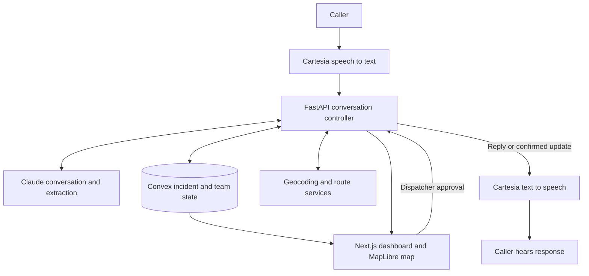

# Flood Rescue Dispatcher — Project Context and Plan

Updated: October 23, 2026

## Current goal

Build a flood-response hackathon prototype in approximately 24 hours with three people. Start with the dispatcher map and dashboard using fictional incidents and simulated rescue teams. Connect caller data after the map experience works.

The project directory is currently empty apart from this plan. No application has been scaffolded, and no backend, model, database, or deployment has been configured.

## Product concept

Help a dispatcher understand who has requested rescue, where they are, and which team could reach them. A voice agent gathers information, the backend prepares an incident, and a human reviews the details and approves an assignment.

The demonstration should complete this flow:

1. A person describes a fictional flood emergency.
2. The system extracts reported location, number of people, and hazards.
3. An incident appears on the dispatcher map.
4. The dispatcher verifies the location and chooses a simulated rescue team.
5. A route suggestion is displayed, based on supplied restrictions.
6. The dispatcher approves the assignment.
7. The voice agent announces the confirmed assignment to the caller.

The project name is undecided. Names discussed include StillHere, Floodlight, RallyPoint, Beacon, and Higher Ground. The workspace name `hurricaneai` is not a settled product name.

## Agreed stack

| Component | Technology | Responsibility |
| --- | --- | --- |
| Frontend | Next.js + TypeScript + Tailwind CSS | Dispatcher dashboard and controls |
| Map renderer | MapLibre GL JS | Incidents, teams, flood areas, and routes |
| Backend | Python + FastAPI + Pydantic | Coordinate conversation, validate incident updates, call external services |
| Voice | Cartesia | Speech recognition, speech generation, and voice interaction |
| Language model | Anthropic Claude | Conversation, follow-up questions, structured fact extraction |
| Shared application state | Convex | Incidents, teams, assignments, and reactive dashboard updates |
| Address lookup | Mapbox Geocoding | Candidate coordinates for a reported address |
| Road routing | Openrouteservice | Suggested route avoiding supplied restricted areas |
| Initial flood context | Clearly labeled simulated flood polygons | A predictable demo in one chosen area |

Convex replaces the earlier Supabase PostgreSQL + Supabase Realtime proposal. Do not build both databases. The earlier PostGIS design is deferred; Convex is not a drop-in replacement for PostGIS queries.

Keep FastAPI for voice orchestration. Use the Convex Python client to call Convex functions. Convex database functions are written in TypeScript. Confirm the Cartesia integration approach before implementation: use its agent framework where suitable rather than assembling unnecessary speech infrastructure.

Custom fine-tuning is not required for the initial product. One hosted language model can perform conversation and incident extraction through separate instructions/tool calls.

## Overall architecture

This is a conceptual diagram, not a specification of exact provider endpoints. The dispatcher interface subscribes to Convex; voice notifications need an explicit backend bridge and are not automatically produced by a database subscription.

## Immediate work: map-first prototype

Build the dashboard independently of voice and backend integrations. Use a local fixture file behind a small data adapter so Convex can replace the fixture source later.

### Suggested layout

- Top bar: project name, selected demo area, and a visible “Simulated exercise” indicator.
- Left panel: incident queue with status, location, reported people count, and short hazard summary.
- Main area: interactive map with incident markers, rescue-team markers, and simulated flood zones.
- Detail panel: selected incident, location verification state, reported facts, transcript placeholder, team selector, and assignment control.
- Small activity feed: incident created, location confirmed, assignment approved, and simulated team updates.

Keep the visual design readable and focused on dispatcher decisions. Distinguish statuses with labels/icons as well as color.

### First interactions

1. Clicking a queue item selects and centers its marker.
2. Clicking a marker opens the same incident details.
3. Status filters update the queue and map consistently.
4. An unclear location is visibly flagged for review.
5. A dispatcher selects an available simulated team and approves an assignment.
6. The incident status and team availability update together.
7. A reset control restores the initial exercise data.

Begin with fixed coordinates and no geocoding or routing API dependency. Add route suggestions after the queue, selection, and assignment flow works. Any placeholder route must be explicitly labeled as simulated.

Use one small demo area. San Diego is a candidate because historical San Diego records appeared in an earlier plan, but the city and dataset have not been selected or validated.

### Map assets and data

- Choose a basemap provider compatible with MapLibre; MapLibre itself does not supply production basemap tiles.
- Retain required map attribution.
- Store fixture coordinates, flood polygons, and team locations in a simple shared format.
- Simulated flood zones are exercise assumptions, not measured water depths.
- Do not present an address match as verified until the dispatcher confirms it.

## Shared data contract — proposed starting point

Finalize this contract together before building integrations. IDs and field names should remain consistent across voice, FastAPI, Convex, and frontend code.

### Incident

| Field | Meaning |
| --- | --- |
| `id` | Stable incident identifier |
| `callId` | Associated call identifier, nullable for map-only fixtures |
| `source` | `live_demo`, `recording`, or `fixture` |
| `exerciseId` | Separates demo/replay sessions |
| `reportedAddress` | Caller-provided location text |
| `latitude`, `longitude` | Nullable candidate or confirmed coordinates |
| `locationVerified` | Whether a dispatcher confirmed the location |
| `peopleCount` | Nullable reported count |
| `reportedPosition` | Floor, roof, vehicle, or other caller-provided position |
| `hazards` | Reported hazards, with source context |
| `summary` | Draft incident summary |
| `transcript` | Conversation or reference to transcript segments |
| `status` | Current incident workflow state |
| `assignedTeamId` | Nullable rescue-team reference |
| `createdAt`, `updatedAt` | Timestamps |
| `version` | Helps detect stale updates |

Unknown information stays null/empty rather than being invented. Preserve evidence from the transcript for material extracted facts.

Suggested statuses:

`needs_review → awaiting_assignment → assigned → en_route → resolved`

Call connection state is separate from incident state. A call ending must not mark a rescue as resolved. A generated route must not mark a team as assigned or en route.

### Rescue team

- `id`, `name`
- Current coordinates
- Availability
- Capabilities, such as a road vehicle or water-rescue equipment
- Current assignment
- Timestamp and indication that the team is simulated

Use a few predefined simulated teams. The dispatcher chooses a team; automatic fleet optimization is outside the initial scope. Road routing does not establish a boat navigation path.

## Conversation and backend consistency

The backend is the source of truth for actions and operational status. The voice model must not promise actions simply because it generated the words.

### While work runs

- Ask useful unanswered questions instead of blocking on geocoding or routing.
- If no useful question remains, allow a natural pause rather than filling silence.
- Do not claim successful submission if saving fails or times out.

### When an action completes

1. Save the confirmed state change.
2. Emit an event tied to the incident and active call.
3. Add the confirmed update to conversation context.
4. Announce it at a suitable pause using approved status wording.

Example events: `incident_created`, `assignment_approved`, `team_en_route`.

Only announce caller-relevant changes. Updating a map marker or calculating a route does not require a spoken notification. Queue ordinary updates while the caller is speaking, discard duplicate/outdated announcements, and stop agent playback when the caller interrupts. Pending database actions must not accidentally be duplicated or lost when speech is interrupted.

## Input paths

### Live demo

Browser microphone → Cartesia → conversation/backend → incident updates.

Use browser audio first. Actual phone calling adds telephony setup and is optional.

### Fictional recorded calls

Upload recording → transcription → Claude fact extraction → backend validation → incident.

A recording cannot answer follow-up questions. Use it to test extraction; test interactive conversation separately with teammates.

### Historical records

Historical San Diego dispatch replay is deferred. Before adding it, verify available fields and access conditions. Keep historical data in a separate exercise with a simulated clock rather than mixing it with live incidents.

## Scope for the first 24 hours

### Core

- One demo area and a small set of fictional incidents.
- Dispatcher queue and interactive map.
- Simulated flood zones and rescue teams.
- Reviewable extracted incident information.
- Human-approved assignment.
- Consistent status across dashboard and voice.
- One complete live voice demo if time permits.

### Add after the core works

- Real address lookup.
- Route suggestions using known exercise restrictions.
- (Want, not need) Recommended team + auto route for one-click dispatcher approval.
- Recorded-call upload UI.
- A second dispatcher screen demonstrating Convex synchronization.

### Defer

- Fine-tuning Mistral or ModernBERT; GPU training infrastructure.
- Automatic cross-call grouping and advanced geographic matching.
- Historical dispatch replay.
- Live flood-model ingestion or custom flood prediction.
- Emotion scoring.
- Real emergency-service/CAD integration.
- Automatic rescue dispatch and fleet optimization.
- Actual phone-number integration unless the browser flow is complete.

NOAA/NWS warnings and river observations can provide context later, but they do not establish exact water depth at every building. A route suggestion is based on supplied data and restrictions, not a guarantee of safe access.

## Three-person ownership

| Person | Owns | First deliverable |
| --- | --- | --- |
| 1 — Voice/AI | Cartesia, Claude, transcript extraction, spoken backend notifications | Fictional conversation creates an incident and receives a confirmed update |
| 2 — Backend/state | FastAPI, validation, Convex schema/functions, assignment rules, voice event bridge | Fake incident reaches Convex and assignment updates are saved consistently |
| 3 — Dashboard/map | Next.js, MapLibre, fixtures, queue/detail interactions, geocoding/routing integration | Usable map and assignment flow against sample data |

Person 3 owns map-service integration work; external API secrets and privileged requests remain server-side. Agree on function/API contracts early so everyone can use fixtures while other components are unfinished.

## Suggested checkpoints

- Hour 0–1: agree on schema, demo area, fixtures, and interfaces.
- By hour 4: fake incident reaches the dashboard through the shared backend/state path; map interactions work.
- By hour 8: live voice or recorded-call extraction creates a real incident record.
- By hour 12: dispatcher assignment triggers a confirmed spoken update.
- Hours 12–20: add routing, address verification, failure handling, and visual polish.
- Final 4 hours: freeze features, reset demo data, test the full flow, record/rehearse the demonstration.

Adjust timing based on the team's start time. Preserve a working fixture-driven dashboard if voice integration takes longer than expected.

## Sponsor tracks

Primary stack-aligned targets:

- **Cartesia:** voice is central, including responsive conversation and interruptions.
- **Anthropic:** Claude performs useful conversation and extraction; describe a specific target community and limitations.
- **Convex:** incident and assignment state synchronizes meaningfully across dispatcher views.

Additional submission possibilities:

- **Microsoft:** high-impact agent workflow; confirm the final event eligibility rules.
- **Notability:** document actual sketches, planning, and test observations if used throughout the build.

Do not add Spacetime alongside Convex. Do not add payment, credit, or unrelated sponsor features just to increase track count. The supplied sponsor document says prizes/rules may change, and detailed Convex criteria were not yet provided.

## Demo and validation

Prepare five fictional scenarios, including an unclear address and a caller correcting their location.

Verify:

- Queue selection and map selection remain synchronized.
- Unknown facts remain unknown and missing locations enter review.
- Assignment state and team availability remain consistent across screens.
- A caller is not told “en route” when the system only saved a request or calculated a route.
- Duplicate or delayed updates do not create duplicate incidents or stale spoken claims.
- Geocoding/routing failure leaves a usable incident and review path.
- A disconnected call remains an unresolved incident until explicitly resolved.
- Simulated data and actual provider results are clearly distinguishable.

Opening demo moment: a fictional caller reports three people upstairs in a flooded building; an incident appears; the dispatcher confirms the location and assigns a simulated team; the caller hears the confirmed assignment.

## Inspiration and research context

DispatchAI inspired the voice-to-dispatcher workflow. Its published Mistral LoRA was trained on 518 text conversations. The public model card demonstrates generating a dispatcher's next reply. Its project description discusses incident summaries, but the current source inspected during planning calls hosted OpenAI models for conversation and analytics. We did not verify the original hackathon runtime or live deployment, so do not claim Mistral was never used.

The lesson for this project: implement the full working flow before deciding whether custom training improves a measured weakness.

Useful references:

- [Cartesia Line](https://github.com/cartesia-ai/line)
- [Convex overview](https://docs.convex.dev/understanding/overview)
- [Convex Python client](https://docs.convex.dev/client/python)
- [MapLibre examples](https://maplibre.org/maplibre-gl-js/docs/examples/)
- [Mapbox geocoding](https://docs.mapbox.com/api/search/)
- [Openrouteservice routing options](https://giscience.github.io/openrouteservice/api-reference/endpoints/directions/routing-options)
- [NOAA water services](https://water.noaa.gov/about/api)
- [NWS flood mapping limitations](https://www.weather.gov/media/owp/operations/nws_fim_faqs.pdf)
- [DispatchAI model](https://huggingface.co/spikecodes/ai-911-operator)
- [DispatchAI dataset](https://huggingface.co/datasets/spikecodes/911-call-transcripts)

## Next action

Implement the map-first dashboard using sample data. Choose the demo area, scaffold Next.js, add MapLibre and a basemap, then build queue selection, incident details, and simulated assignment controls. Do not wait for caller data, model training, or external routing APIs to start the interface.
