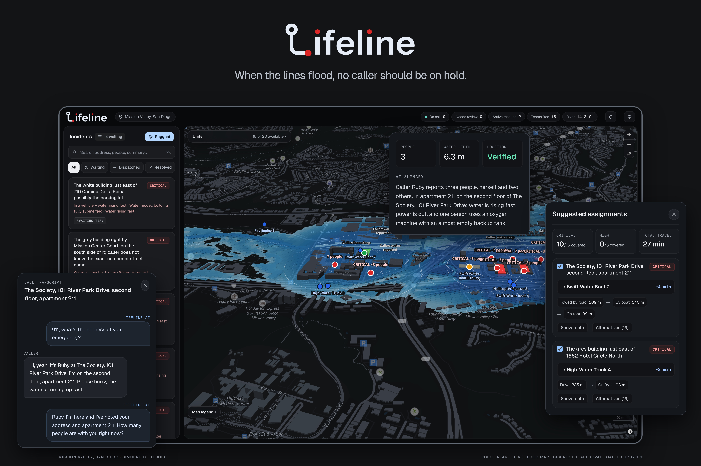
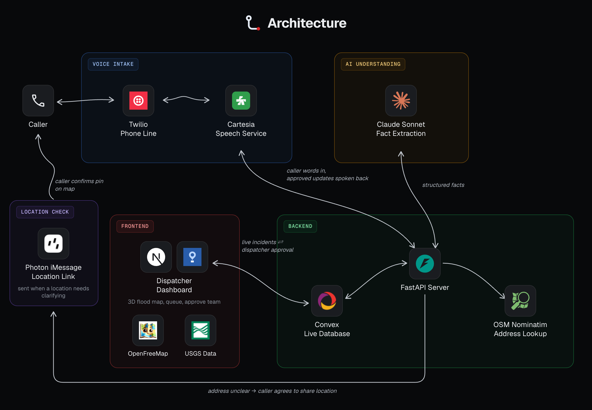

# Lifeline

**Every call should become a clear next step.**

Lifeline is a flood-response prototype that turns a caller's spoken report into an incident a dispatcher can review and act on. Callers describe where they are, who needs help, and what the water is doing. Dispatchers review those details on a live map, confirm the location, and approve rescue assignments. Confirmed updates are spoken back to the caller.

Built for **Cal Hacks 13.0**. Demonstrate with fictional incidents.



## How we use Convex
Convex stores incidents, transcripts, rescue teams, and dispatcher decisions.
Realtime queries update the console's queue, map, details, and activity without refreshing.
Mutations validate assignments; scheduled functions advance simulated trips and rescues.
See [the Convex hackathon log](hackathon.md) for source evidence and dated milestones.

## One call, one coordinated response

1. **Listen.** Twilio carries phone audio; Cartesia transcribes the caller and detects turns. A browser microphone entry point supports the same core conversation.
2. **Understand.** Claude extracts incident facts and asks follow-up questions. Corrections retain their evidence; unknown details stay unknown.
3. **Locate.** Review an address-based map candidate, or let an eligible phone caller consent to a Photon iMessage location link. Caller confirmation of device location and dispatcher verification are separate steps.
4. **Coordinate.** Review priorities, duplicate reports, flood estimates, and suggested assignments. A dispatcher approves the response.
5. **Keep the caller informed.** Cartesia speaks approved updates. Our conversation controller handles interruptions and checks that queued announcements still match dispatcher decisions.

The MapLibre map combines terrain elevation, OpenStreetMap roads and buildings, historical river-gauge or tide replay, and caller-reported water conditions. Flood-aware routes and animated team trips support simulated exercises in Mission Valley and the Golden Gate shore area.

## Architecture



FastAPI connects Twilio audio to Cartesia, exchanges structured incident information with Claude, and persists state in Convex. The dispatcher dashboard subscribes directly to Convex updates; Photon provides consent-based location sharing.

## What Cartesia contributes

Voice is the intake and feedback loop: callers can report their situation and hear dispatcher updates without operating the dashboard. Cartesia supplies streaming speech recognition with turn detection and speech synthesis. FastAPI connects those speech APIs to Claude and Convex; Twilio supplies telephony, and Photon supplies optional location sharing.

See [Cartesia setup, the two-minute demo flow, and limitations](CARTESIA.md). The implementation is in [voice_provider.py](backend/app/voice_provider.py), [voice.py](backend/app/voice.py), and [twilio_media.py](backend/app/twilio_media.py).

## Run locally

Use Node.js 22.9+ and Python 3.11+. From the repository root:

```sh
python3 -m venv backend/.venv
backend/.venv/bin/pip install -r backend/requirements-dev.txt
npm --prefix dashboard ci
```

Create an ignored `backend/.env` privately. Set `ANTHROPIC_API_KEY`, `CARTESIA_API_KEY`, and a locally generated `VOICE_BRIDGE_TOKEN`. For speech output, provide `CARTESIA_AGENT_ID` to reuse an existing agent's voice settings, or provide both `CARTESIA_VOICE_ID` and `CARTESIA_TTS_MODEL`. Keep credentials out of source control and screenshots.

Start an isolated local exercise with these ports free:

```sh
backend/.venv/bin/python backend/scripts/run_local_voice.py \
  --convex-port 3320 --convex-site-port 3321 \
  --api-port 8000 --dashboard-port 3100
```

The existing launcher starts local Convex, FastAPI, and Next.js. It generates matching backend and dispatcher credentials, overrides deployment settings in child processes, and prints a private state directory. The Convex CLI may download its local backend on first use.

- Open [the console](http://localhost:3100/console). Enter the passcode from the printed state directory's `dispatcher-token` file.
- Open [the browser voice entry point](http://localhost:8000/voice), enter your bridge token, and allow microphone access. Use headphones.
- Keep the call open while confirming its location and assigning a team in the console, then listen for the approved update.

Each invocation creates a new local exercise. Ctrl+C stops its child processes and retains its private state directory. It does not reset a shared cloud deployment. A different API port also requires configuring `NEXT_PUBLIC_BACKEND_URL` for the dashboard process.

The console's **Demo simulation** controls run Claude-played text callers through the backend. This exercises coordination and team movement; it does not exercise microphone input or Cartesia speech. See [phone setup](CARTESIA.md#phone-entry-point) and [optional Photon setup](integrations/photon/README.md) for those integrations.

## Checks

Run fixture checks without placing real calls:

```sh
backend/.venv/bin/python -m pytest backend/tests
npm --prefix dashboard run test:voice
npm --prefix dashboard run test:priority
```

`scripts/demo/validate.py` also provides isolated integration checks and an optional temporary-copy dashboard build. Automated fixtures do not establish real microphone quality, provider availability, or live phone delivery; rehearse the complete voice flow before presenting.

## Limits and responsible use

- This is a prototype with simulated flooding and accelerated team movement. Routes and priorities need human review; they are not operational flood forecasts or dispatch instructions.
- Speech recognition and extraction can misunderstand names, addresses, accents, or interruptions. Callers can correct details, and dispatchers must confirm locations before assigning teams.
- Transcripts and incident details persist in Convex. Audio goes to Cartesia and incident text to Anthropic. Optional location sharing sends a fix only after caller confirmation. A complete retention and deletion policy remains unfinished.
- Dispatcher and voice access controls are optional in code. The isolated launcher configures credentials; public deployment needs deliberate access-control and privacy setup.
- Voice provides a hands-free reporting path; transcripts provide a visual record. Multilingual support, SMS intake, and formal accessibility evaluation remain future work.

## Source map

| Directory | Responsibility |
| --- | --- |
| `dashboard/src/` | Next.js pages, console, maps, flood model, routing |
| `dashboard/convex/` | Schema, queries, mutations, assignment review, scheduled trips |
| `backend/` | FastAPI, Claude extraction, Cartesia speech, Twilio, simulation |
| `integrations/photon/` | iMessage location cards and caller confirmation |
| `ml/` | Optional ModernBERT training and advisory classification |
| `scripts/`, `tests/` | Cross-service tooling and integration checks |

Judge source: [Htetty/lifeline](https://github.com/Htetty/lifeline). The application is under `dashboard/`; root-level Next.js starter files are not the product entry point. No public frontend or demo video is established by this README.
